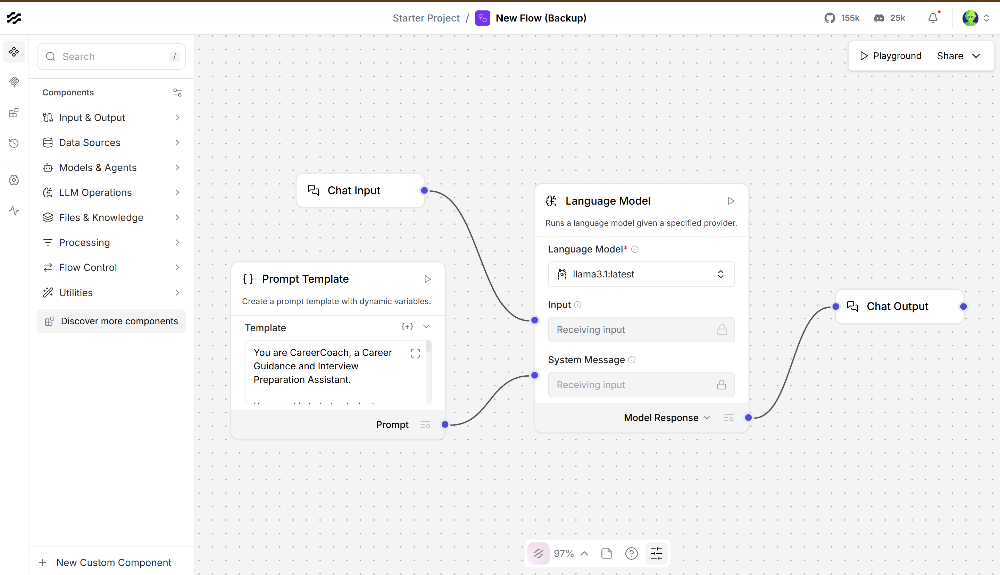

# CareerCoach — Career Guidance Assistant (LangFlow)

A domain-specific smart chatbot built in **LangFlow**. **CareerCoach** helps students prepare for interviews, sharpen resume points, and understand professional and technical concepts. It runs on **Llama 3.1** served locally through **Ollama**.



---

## What it can do

- **Interview prep** for HR, technical, business analyst and consulting roles
- **Resume bullet improvement** with strong action verbs and a focus on skills and impact
- **Behavioural answers** using the **STAR** method (Situation, Task, Action, Result)
- **Mock interviews** — one question at a time, waits for your answer, then gives feedback
- **Concept explanations** — simple definitions with practical examples
- **Gap spotting** — points out what's missing in an answer and how to improve it

It is told **never to invent** your experience, skills, achievements or numbers, and to ask a short follow-up question when key details are missing.

---

## Flow architecture

```
Prompt Template ──(system message)──┐
                                    ▼
Chat Input ──(input)──────► Language Model (Ollama · llama3.1) ──► Chat Output
```

| Component | Setting |
|---|---|
| **Chat Input** | User message, stored in chat history |
| **Prompt Template** | CareerCoach system prompt (`Prompt.txt`), wired into the model's *System Message* |
| **Language Model** | Provider Ollama · model `llama3.1:latest` · base URL `http://127.0.0.1:11434` · temperature `0.1` · streaming off |
| **Chat Output** | Shows the model response in the Playground |

The low temperature (0.1) keeps answers consistent and focused.

---

## Files in this folder

| File | Description |
|---|---|
| `CareerCoach - Career Guidance Assistant..json` | Exported LangFlow flow — import this into LangFlow |
| `Prompt.txt` | CareerCoach system prompt |
| `1..png` | Flow canvas in LangFlow |
| `2.png` | Playground chat — Business Analyst interview prep example |

---

## Prerequisites

- **LangFlow** (desktop or `pip install langflow`)
- **Ollama** running locally with Llama 3.1:
  ```bash
  ollama pull llama3.1
  ollama serve
  ```

---

## Setup & run

1. Start LangFlow:
   ```bash
   langflow run
   ```
   then open `http://127.0.0.1:7860`.
2. **Import** the flow: *New Flow → Import* → `CareerCoach - Career Guidance Assistant..json`.
3. In the **Language Model** node, check that the provider is **Ollama**, the model is `llama3.1:latest`, and the base URL points to your Ollama server.
4. Click **Playground** and start chatting.

---

## Example prompts

- *Help me prepare for a Business Analyst interview.*
- *Run a mock HR interview with me — one question at a time.*
- *Improve this resume point: "Worked on a dashboard for sales data."*
- *Help me frame a STAR answer about handling a conflict in a group project.* (then give your real details)
- *Explain the difference between supervised and unsupervised learning with an example.*
- *What should I say when asked "Why consulting?"*

**Sample output** (`2.png`): for the Business Analyst prompt, CareerCoach lists key skills to focus on (BA methodologies like BABOK/Agile, requirements gathering, data analysis, process improvement, stakeholder management) followed by common interview questions.

---

## System prompt (summary)

> You are CareerCoach, a Career Guidance and Interview Preparation Assistant… Provide clear, professional answers; help with HR, technical, BA and consulting interviews; use strong action verbs for resumes; never invent the user's experience or numbers; use STAR for behavioural answers; ask one mock-interview question at a time; identify gaps and suggest improvements; ask for clarification when information is missing.

Full text: `Prompt.txt`.

---

## Possible improvements

- Add a **Message History / Memory** component so mock interviews keep context across many turns.
- Add a **File** input so users can upload a resume for review.
- Add a **Retriever** over a question bank (company- or role-specific) for more targeted practice.

---

## Tech stack

LangFlow · Ollama (Llama 3.1)
