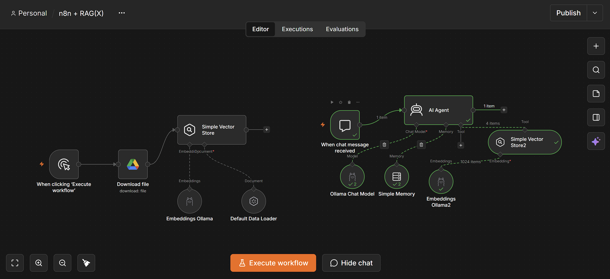

# n8n + RAG — Everyday Health & Wellness Assistant

A Retrieval-Augmented Generation (RAG) chatbot built in **n8n**. It reads a wellness knowledge-base document from Google Drive, turns it into vector embeddings, and answers chat questions **only** from what it finds in that document. If the answer isn't in the document, the bot says so instead of guessing.

Everything runs locally: the language model and the embedding model are served by **Ollama**.



---

## What it does

- Loads `Everyday_Health_and_Wellness_RAG_Knowledge_Base.docx` from Google Drive.
- Splits it into chunks, embeds them with `mxbai-embed-large`, and stores them in an in-memory vector store.
- Gives a chat interface where an AI agent (Llama 3.1) searches the vector store before answering.
- Stays grounded: no diagnoses, no medicine suggestions, no made-up numbers. Out-of-scope questions get a polite "not in the knowledge base" reply.

Topics covered by the knowledge base: **sleep, hydration, physical activity, and balanced eating** (based on CDC and WHO guidance).

---

## Architecture

The workflow has two parts.

### 1. Ingestion pipeline (run once)

```
Manual Trigger ──► Google Drive: Download file ──► Simple Vector Store (Insert)
                                                     ├── Default Data Loader (binary .docx)
                                                     └── Embeddings Ollama (mxbai-embed-large)
```

| Node | Type | Role |
|---|---|---|
| When clicking 'Execute workflow' | Manual Trigger | Starts ingestion |
| Download file | Google Drive | Downloads the knowledge-base `.docx` |
| Default Data Loader | LangChain Document Loader | Reads the binary file into documents |
| Embeddings Ollama | Ollama Embeddings | `mxbai-embed-large:latest` |
| Simple Vector Store | In-Memory Vector Store | Mode **Insert**, memory key `vector_store_key` |

### 2. Chat / retrieval pipeline

```
Chat Trigger ──► AI Agent
                  ├── Chat Model:  Ollama Chat Model (llama3.1:latest)
                  ├── Memory:      Simple Memory (window buffer)
                  └── Tool:        Simple Vector Store2 (Retrieve as Tool, top-k = 4)
                                     └── Embeddings Ollama2 (mxbai-embed-large)
```

| Node | Type | Role |
|---|---|---|
| When chat message received | Chat Trigger | Chat UI entry point |
| AI Agent | LangChain Agent | Uses the system prompt in `Agent Prompt.txt` |
| Ollama Chat Model | Ollama Chat | `llama3.1:latest` |
| Simple Memory | Window Buffer Memory | Keeps recent conversation turns |
| Simple Vector Store2 | In-Memory Vector Store | Mode **Retrieve Documents (As Tool for AI Agent)**, same key `vector_store_key`, limit 4 |
| Embeddings Ollama2 | Ollama Embeddings | Embeds the query with the same model used at ingestion |

Both vector-store nodes share the memory key `vector_store_key`, so the retriever reads what the ingestion step wrote.

---

## Files in this folder

| File | Description |
|---|---|
| `n8n + RAG(X).json` | Exported n8n workflow — import this into n8n |
| `RAG_Knowledge_Base.docx` | The knowledge-base document (upload to your Google Drive) |
| `Agent Prompt.txt` | System prompt for the AI Agent |
| `1.png` – `7.png` | Screenshots: workflow canvas, ingestion run, vector store settings, retrieval output and chat answers |

---

## Prerequisites

- **n8n** (self-hosted or desktop) with the LangChain / AI nodes
- **Ollama** running locally (default `http://localhost:11434`)
- Models pulled:
  ```bash
  ollama pull llama3.1
  ollama pull mxbai-embed-large
  ```
- A **Google Drive OAuth2** credential in n8n

---

## Setup & run

1. **Upload the document.** Put `RAG_Knowledge_Base.docx` in your Google Drive.
2. **Import the workflow.** In n8n: *Workflows → Import from File →* `n8n + RAG(X).json`.
3. **Connect credentials.**
   - *Download file* → select your Google Drive credential and pick the uploaded file.
   - *Ollama Chat Model*, *Embeddings Ollama*, *Embeddings Ollama2* → select your Ollama credential.
4. **Ingest.** Click **Execute workflow**. The Simple Vector Store should report the inserted chunks (≈10 items in the screenshots).
5. **Chat.** Open the chat panel and ask a question.

> **Note:** The Simple Vector Store lives in memory. If n8n restarts, run step 4 again before chatting.

---

## Sample questions

Answerable from the knowledge base:

- Why is sleep important?
- How much sleep do adults generally need? → *at least 7 hours per night*
- How much moderate-intensity activity does WHO recommend for adults? → *150–300 minutes per week*
- What are examples of foods in a balanced eating pattern?
- How much water should everyone drink each day? → *no single amount suits everyone*

Should be refused / redirected:

- Which medicine should I take for my symptoms?
- Can this chatbot diagnose a disease?
- What calorie target should I follow?

Expected refusal: *"I couldn't find that information in the provided knowledge base."* (plus a suggestion to see a qualified healthcare professional for personal medical questions).

---

## Grounding rules (from the system prompt)

- Always call the vector store tool before answering.
- Answer only from retrieved content; keep numbers exactly as written.
- No diagnosis, medication advice, or personalised plans.
- Say clearly when the answer isn't in the knowledge base.

---

## Known issue

The **tool description** on *Simple Vector Store2* still contains text from an earlier Credit Appraisal project (loan eligibility, bureau score, LTV, FOIR…). The agent still works because the first paragraph and the system prompt describe the wellness scope, but the description should be trimmed to just the wellness text, e.g.:

> Search the Everyday Health and Wellness RAG Knowledge Base for information about sleep habits, hydration, physical activity, and balanced eating. Use only information explicitly stated in the knowledge base. If something is not specified, say it is not available.

---

## Tech stack

n8n · LangChain nodes · Ollama (Llama 3.1, mxbai-embed-large) · In-memory vector store · Google Drive

## Disclaimer

For educational demonstration of document-grounded retrieval only. Not a substitute for professional medical advice.
