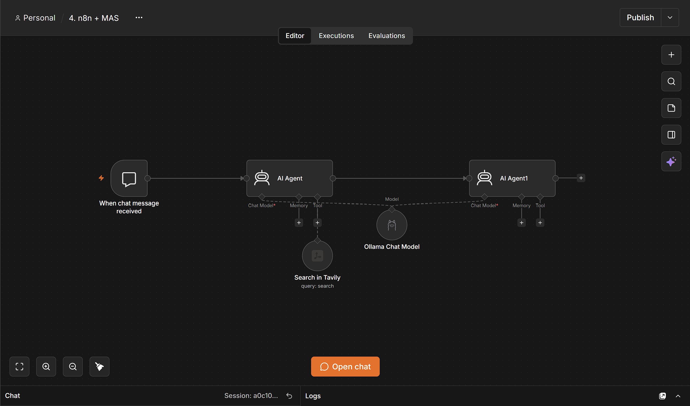

# n8n + MAS — Sequential Multi-Agent Research Assistant

A **sequential multi-agent system (MAS)** built in **n8n**. Two AI agents work one after the other on every chat question:

1. a **Research Agent** searches the web with **Tavily** and compiles an evidence report, then
2. an **Analysis Agent** reads that report and writes the final, user-facing answer.

Both agents run on **Llama 3.1** served locally through **Ollama**.



---

## How it works

```
Chat Trigger ──► AI Agent (Research) ──► AI Agent1 (Analysis & Final Response) ──► reply
                    ├── Tool: Search in Tavily
                    └── Model: Ollama Chat Model (llama3.1) ◄── shared ──┘
```

| Node | Type | Role |
|---|---|---|
| When chat message received | Chat Trigger | Takes the user's question |
| AI Agent | LangChain Agent | **Research Agent** — prompt in `Agent 1.txt`; calls Tavily, returns an organised research report |
| Search in Tavily | Tavily Tool | Web search; the query is filled in by the agent (`$fromAI('Query')`) |
| Ollama Chat Model | Ollama Chat | `llama3.1:latest`, shared by both agents |
| AI Agent1 | LangChain Agent | **Analysis Agent** — prompt in `Agent 2.txt`; input is `{{ $json.output }}` (the research report); returns the final answer |

### Agent roles

**Agent 1 — Web Research Agent**
- Breaks the question into keywords and subtopics.
- Searches with Tavily, pulling facts, statistics, examples, trends and different viewpoints.
- Keeps source URLs, removes noise, and flags gaps or unverified claims.
- Does **not** answer the user — it hands an evidence report to the next agent.

**Agent 2 — Analysis & Final Response Agent**
- Reads the research report and picks what's relevant.
- Adapts the output to the question: explanation, summary, comparison, sentiment analysis, recommendations, or conclusion.
- Bases claims on the supplied research only; notes conflicts or gaps instead of guessing.
- Returns the finished answer to the user.

---

## Files in this folder

| File | Description |
|---|---|
| `4. n8n + MAS.json` | Exported n8n workflow — import this into n8n |
| `Agent 1.txt` | System prompt for the Research Agent |
| `Agent 2.txt` | System prompt for the Analysis & Final Response Agent |
| `1.png` | Workflow canvas |
| `2.png` | Successful run with execution logs and Research Agent output |
| `3.png` | Chat view with the final answer |

---

## Prerequisites

- **n8n** with the LangChain / AI nodes
- The **Tavily community node** (`@tavily/n8n-nodes-tavily`) — install from *Settings → Community Nodes*
- A **Tavily API key** (from tavily.com)
- **Ollama** running locally with Llama 3.1:
  ```bash
  ollama pull llama3.1
  ```

---

## Setup & run

1. **Import** `4. n8n + MAS.json` (*Workflows → Import from File*).
2. **Credentials**
   - *Search in Tavily* → add your Tavily API credential.
   - *Ollama Chat Model* → select your Ollama credential (default `http://localhost:11434`).
3. **Open chat** and send a question.

---

## Example

**Question:**
> What are the major applications of Generative AI in supply chain management, and what are its main benefits and challenges?

**What happens:**
- The Research Agent runs Tavily searches and returns findings on demand forecasting, inventory management, route optimisation, predictive maintenance and supply-chain design, plus benefits and challenges.
- The Analysis Agent turns that into a structured answer: *Overview → Main Applications and Benefits → Challenges → Recommendations*.

In the recorded run the full pipeline finished in about 9 minutes using ~5,500 tokens on a local Llama 3.1 model (see `2.png`).

Other questions to try:
- Summarise recent trends in quick-commerce in India.
- Compare LangFlow and n8n for building AI agents.
- What is the public sentiment around electric vehicles in 2026?

---

## Notes & possible improvements

- **Original question for Agent 2:** Agent 2 receives only Agent 1's output. This works because Agent 1 is told to restate the user's query at the top of its report. For more reliability, pass the question explicitly, e.g. set Agent 2's prompt to
  `Question: {{ $('When chat message received').item.json.chatInput }}\n\nResearch:\n{{ $json.output }}`.
- **Memory:** no memory node is attached, so each question is handled on its own. Add a *Simple Memory* node to Agent 2 for follow-up questions.
- **Speed:** local Llama 3.1 is slow on long multi-step runs; a hosted model (or a smaller local one) will respond faster.

---

## Tech stack

n8n · LangChain Agent nodes · Ollama (Llama 3.1) · Tavily Search API
